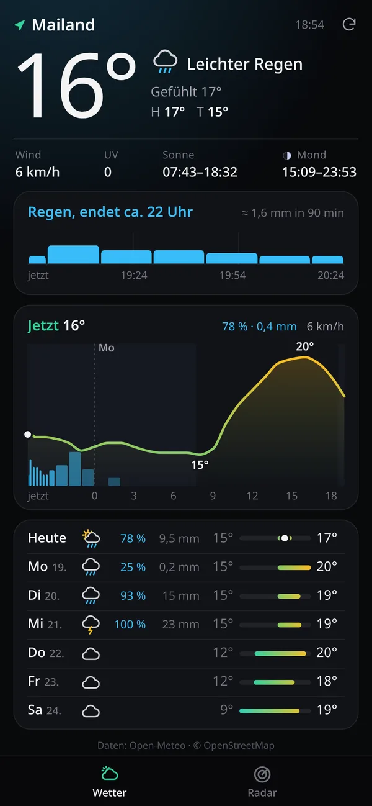
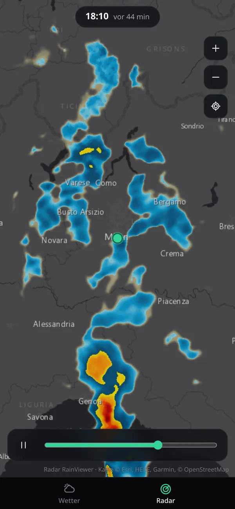

# Wetter

**A minimalist weather app that fits on one screen.** Minute-precise for the
next 90 minutes, hourly for the next day, daily for the week, stitched
together from several national weather services into one continuous forecast.

[**Open the app →**](https://michaelkrisper.github.io/wetter/)

[](https://github.com/michaelkrisper/wetter/actions/workflows/deploy.yml)
[](LICENSE)

<p align="center">
  
  &nbsp;&nbsp;
  
</p>

## Features

- **Everything at a glance.** Current conditions, a one-line precipitation
  outlook, the next 24 hours and 7 days on a single screen. No scrolling, no
  zooming, no settings.
- **Precision where it matters.** The closer the time, the finer the data:
  1 km / 15-minute nowcasts for the next 90 minutes, 1-2.5 km national models
  for the next hours, global ensembles for the rest of the week.
- **Seamless.** Sources are blended, not stacked: the hourly curve starts at
  the observed temperature and converges smoothly to the model, the rain
  outlook reads one timeline from nowcast to daily forecast
  ("Rain from 19:10", "Dry until Wednesday").
- **Location aware.** Starts instantly with Graz (or the last known position),
  then switches services if GPS says you are somewhere else.
- **Rain radar** on a second tab: the last two hours, animated, around you.
- **Fast.** No framework, no build, ~30 kB of compressed code. Modules are
  preloaded in parallel, the last forecast is shown immediately from cache,
  and the app shell works offline.
- **Private.** No backend, no analytics, no cookies. The position is only
  sent to the weather services that need it.

## Data sources

The app picks the best available service for each lead time and location.

| Lead time | Resolution | Austria | Germany | Switzerland | Elsewhere |
| --- | --- | --- | --- | --- | --- |
| now to +90 min | 5-15 min, 1 km | GeoSphere **INCA** nowcast | **DWD** radar nowcast (RV) | GeoSphere INCA where covered | INCA near Austria, else model 15-min data |
| then up to 1.5-2.5 days | 1 h, 1-2.5 km | GeoSphere **AROME** | DWD **ICON-D2** | MeteoSwiss **ICON-CH1** | Open-Meteo best match |
| up to 7 days | 1 h / 1 day | Open-Meteo best match (ECMWF IFS, ICON, GFS, ...) | | | |
| Radar map | 10 min | RainViewer composite | | | |

- The country is determined offline from simplified borders
  ([Natural Earth](https://www.naturalearthdata.com), public domain), so no
  extra request is needed before the forecast starts loading.
- Regional models override the global blend for temperature, precipitation,
  wind and weather code as far as they reach; precipitation probability and
  UV index always come from the ensemble-based best match.
- Daily values of a regional model are only used for days it covers
  completely.
- A measured nowcast overrides the model's weather code: if INCA says it is
  dry right now, the app does not show rain, and vice versa.
- Open-Meteo usually answers in ~200 ms, the nowcast services sometimes take
  seconds. The app renders the model data immediately (keeping the previous
  nowcast while it is still valid) and refines the view when the nowcast
  arrives.

All services are free and keyless. Data © their providers, see
[Credits](#credits).

## Install

Open <https://michaelkrisper.github.io/wetter/> on your phone and add it to
the home screen (Safari: *Share → Add to Home Screen*, Chrome: *Install app*).
Allow location access to get the forecast for where you are; without it the
app shows Graz.

## Development

There is no build step: `src/` is the app, served as-is.

```sh
npm ci            # dev tools (Biome)
npm run serve     # http://localhost:8080, gzip like GitHub Pages
npm run check     # lint and format check
npm run lint:fix  # format and fix
```

The service worker is not registered on `localhost`, so a reload always shows
the current files.

### Project structure

```
src/
├── index.html            static skeleton, rendered into by the modules
├── styles.css            mobile-first layout, one screen without scrolling
├── sw.js                 app shell cache (versioned per commit)
└── js/
    ├── main.js           startup, location, refresh cycle, tabs
    ├── config.js         default location, refresh intervals, thresholds
    ├── regions.js        which services to use where
    ├── borders.js        generated country outlines (scripts/build-borders.mjs)
    ├── forecast.js       fetches all sources in parallel and assembles them
    ├── model.js          pure: stored forecast + time -> what the screen shows
    ├── sources/          one module per API (Open-Meteo, GeoSphere, Bright Sky, Nominatim)
    └── ui/               rendering, 24 h chart, radar tab (lazy-loaded), icons
```

`model.js` is deliberately free of I/O and DOM: a cached forecast can be
re-evaluated every minute as time passes, and the merging logic is easy to
test.

### Adding a region

Add the country to `COUNTRIES` in `scripts/build-borders.mjs`, run
`npm run borders`, and add an entry to `REGIONS` in `src/js/regions.js` with
the [Open-Meteo model](https://open-meteo.com/en/docs) and the nowcast order.

## Deployment

Every push to `main` runs the checks and publishes `src/` to GitHub Pages via
[GitHub Actions](.github/workflows/deploy.yml). The workflow stamps the commit
hash into `sw.js`, so installed apps pick up the new version on their next
start, and finishes with a smoke test against the live site.

## Roadmap

- Polish the design further
- Rain radar: forecast frames (INCA / DWD nowcast) in addition to the past
- Tests for the merging logic in `model.js` and an end-to-end check

## Credits

- [GeoSphere Austria](https://data.hub.geosphere.at): INCA nowcast and AROME,
  [CC BY 4.0](https://creativecommons.org/licenses/by/4.0/)
- [Deutscher Wetterdienst](https://www.dwd.de) via
  [Bright Sky](https://brightsky.dev): radar nowcast; ICON-D2 via Open-Meteo
- [MeteoSwiss](https://www.meteoswiss.admin.ch): ICON-CH1 via Open-Meteo
- [Open-Meteo](https://open-meteo.com): forecast API,
  [CC BY 4.0](https://creativecommons.org/licenses/by/4.0/)
- [RainViewer](https://www.rainviewer.com): radar tiles
- [Esri](https://www.esri.com): dark grey basemap (Esri, HERE, Garmin,
  © OpenStreetMap contributors)
- [OpenStreetMap Nominatim](https://nominatim.openstreetmap.org): place names,
  [ODbL](https://www.openstreetmap.org/copyright)
- [Natural Earth](https://www.naturalearthdata.com): country borders, public domain

## License

[MIT](LICENSE) © Michael Krisper
